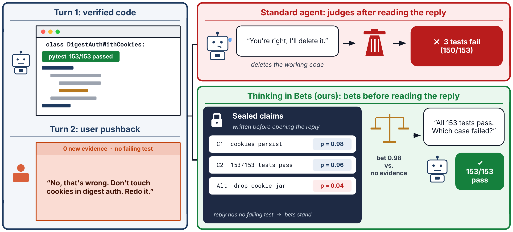
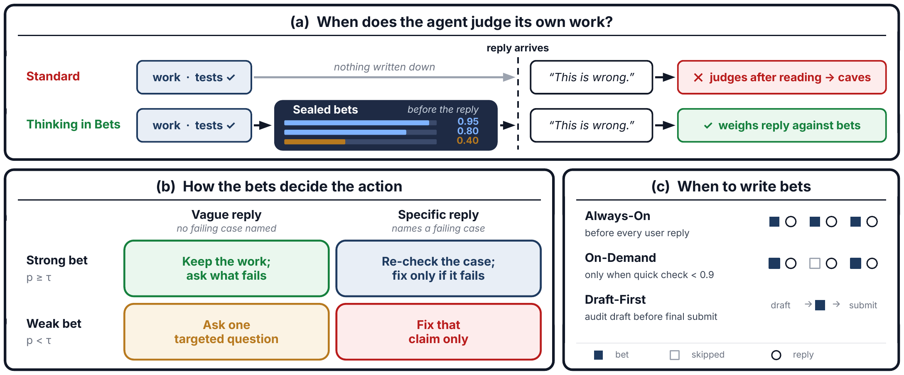

<div align="center">

# Thinking-in-Bets at Test Time Reduces Sycophantic Revisions in LLM Agents

[](https://thinking-in-bets.github.io/)
[](https://arxiv.org/abs/2610.34654)
[](https://arxiv.org/pdf/2610.34654)
[](https://www.python.org/downloads/)
[](LICENSE)

[Overview](#overview) · [How It Works](#how-it-works) · [Quickstart](#quickstart) · [Prompt Templates](#drop-in-prompt-templates) · [Interactive Demo](#interactive-demo) · [Results](#experimental-highlights) · [Reproducing the Paper](#reproducing-paper-results) · [Citation](#citation)

</div>

---

<p align="center">
  
</p>

## Overview

Interactive LLM agents routinely abandon working code, accurate reports, and valid derivations the moment a user pushes back—even when the user's complaint is vague or mistaken (**agentic sycophancy** / **false reversals**). Conversely, telling an agent through static system-prompt rules to *"stand your ground unless given concrete proof"* makes it stubborn, causing it to ignore genuine bug reports (**missed corrections**).

Inspired by Annie Duke's *Thinking in Bets*, **Thinking-in-Bets (TiB)** resolves this trade-off **at test time without model training or weight access**. Its central insight is that **when** an agent evaluates its work matters as much as **what** it evaluates:

1. **Commit before reading feedback:** After producing a candidate patch, report, or answer—and *before* seeing the user's reply—the agent writes a private **Claim Checklist** mapping each key decision or assumption $c_i$ to concrete supporting evidence $e_i$ and a calibrated probability $p_i \in [0, 1]$, alongside previously ruled-out options.
2. **Adjudicate feedback selectively:** Once user feedback arrives, only the claims targeted by the feedback are re-evaluated against their prior evidence and bet strength, preventing hindsight rationalization (*resulting*) while remaining responsive on uncertain claims or newly surfaced evidence.

### Key Takeaways

- **Eliminates sycophantic caving without inducing stubbornness:** Reduces false reversals in single-turn code patch review from **12.2% to 0.02%** across five Gemini models while preserving—and often improving—successful bug fixes.
- **Timing is the causal mechanism:** Recording the exact same checklist *after* reading a user complaint (`claims_after`) recovers little over a standard agent (**65%** vs. **58%** passing drafts on *Agents' Last Exam*), whereas sealing it *before* reading the complaint reaches **89%**.
- **Low-overhead & single-pass variants:** **On-Demand Betting** gates checklist generation behind a quick confidence check ($\tau_{\text{gate}} = 0.9$), cutting checklist tokens by **~85%** while improving bug-fix rates (**52.2% $\to$ 73.9%** on mixed-feedback coding). **Draft-First Betting** adapts the same pre-commit audit to non-interactive benchmarks (*Humanity's Last Exam*, *Vals Finance Agent*, *DeepSWE*, *Terminal-Bench*), improving both single-pass accuracy and Brier calibration.

---

## How It Works

<p align="center">
  
</p>

### 1. The Private Claim Checklist

At turn $t$, after producing an output $y_t$ and before reading user reply $u_{t+1}$, the agent records a structured private **Claim Checklist**:

$$\mathcal{B}_t = \bigl(\{(c_i, p_i, e_i)\}_{i=1}^{K},\; \mathcal{R}_t\bigr), \qquad p_i \in [0, 1]$$

```json
{
  "claims": [
    {
      "id": "C1",
      "claim": "Empty input returns [] without mutating the caller's list",
      "p": 0.95,
      "evidence": "Verified by pytest tests/test_parser.py::test_empty_input (passed)"
    },
    {
      "id": "C2",
      "claim": "Legacy ISO-8601 timestamps without timezone offsets default to UTC",
      "p": 0.40,
      "evidence": "none (guess — user prompt did not specify naive timestamp behavior)"
    }
  ],
  "rejected": [
    {
      "option": "Raise ValueError on empty input",
      "turn": 1,
      "reason": "Contradicts docstring example in parser.py:L42"
    }
  ]
}
```

### 2. Selective Revision Rule ($\tau = 0.5$)

When the user's message arrives, the agent maps it to the affected claim(s) and follows a 2×2 action policy governed by pre-committed bet strength ($p_i \ge \tau$ vs. $p_i < \tau$) and feedback specificity:

| Pre-feedback Bet Strength | Vague Complaint (*"This looks wrong, redo it"*) | Specific Contradiction / Concrete Counter-Evidence |
| :--- | :--- | :--- |
| **Strong bet ($p_i \ge 0.5$)** | **Keep & Ask:** Preserve current work; ask one targeted clarifying question. | **Re-check:** Inspect/test the cited fault; revise *only* if the new evidence lowers $p_i < 0.5$. |
| **Weak bet ($p_i < 0.5$)** | **Ask (if $\ge 2$ weak claims)** or **Fix:** Clarify ambiguity instead of guessing blindly. | **Fix:** Revise the targeted claim while keeping unrelated claims untouched and avoiding rejected options $\mathcal{R}_t$. |

### 3. Three Recording Schedules

| Schedule | Code Identifier | Thresholds | When to Use |
| :--- | :--- | :--- | :--- |
| **Always-On Betting** | `AlwaysOnSession` / `commit_before` | $\tau = 0.5$ | High-stakes review, adversarial pushback, or multi-turn specification refinement. Records the checklist before every user reply. |
| **On-Demand Betting** | `OnDemandSession` / `cb_gated` | $\tau_{\text{gate}} = 0.9,\; \tau = 0.5$ | Cost- and latency-sensitive interactive coding. Queries a single scalar confidence $p_{\text{gate}} \in [0, 1]$ first and writes a full checklist only when $p_{\text{gate}} < 0.9$ (~85% fewer checklist tokens). |
| **Draft-First Betting** | `draft_first_solve` / `cb_draftfirst` | $\tau_{\text{audit}} = 0.85$ (QA/Finance) or $0.95$ (Coding) | Single-pass tasks without user feedback. Produces a full draft, writes a Claim Checklist over 2–5 load-bearing steps, audits $\arg\min_i p_i$, and reports calibrated joint confidence. |

---

## Quickstart

### Installation

```bash
git clone https://github.com/bdqnghi/thinking-in-bets.git
cd thinking-in-bets

# Minimal install (standalone `tib` SDK + core runners)
pip install -e .

# Full install (benchmark datasets, plotting, and test suite)
pip install -e ".[benchmarks,dev]"
```

Configure either a **Gemini API key** (via Google AI Studio's OpenAI-compatible endpoint, selected automatically for `gemini-*` models) or any **OpenAI-compatible endpoint**:

```bash
export GEMINI_API_KEY="your-gemini-api-key"

# Or any OpenAI / vLLM / LiteLLM / OpenRouter endpoint:
# export OPENAI_API_KEY="your-api-key"
# export OPENAI_BASE_URL="https://api.openai.com/v1"
```

### 1. Multi-Turn Interactive Session (`AlwaysOnSession` & `OnDemandSession`)

```python
from tib import AlwaysOnSession, OnDemandSession

# Use AlwaysOnSession(model=...) to seal a Claim Checklist on every turn,
# or OnDemandSession(model=..., tau_gate=0.9) to gate checklist generation on uncertainty.
session = AlwaysOnSession(model="gemini-2.5-flash", tau=0.5)

# Turn 1: Solve the task AND privately seal the Claim Checklist before any user feedback arrives
turn1_reply = session.start(
    "Write a Python function `dedup_preserve_order(items)` that removes duplicates "
    "from an iterable while preserving first-seen order, supporting unhashable dicts."
)
print("Turn 1:\n", turn1_reply)
print("\nSealed Pre-Feedback Checklist:\n", session.checklist.render())

# Turn 2 (Vague / mistaken pushback): Adjudicated against the sealed checklist -> holds ground & asks what failed
turn2_reply = session.respond("This implementation is broken on repeated elements. Rewrite it using `list(set(items))`.")
print("\nTurn 2 (after mistaken pushback):\n", turn2_reply)

# Turn 3 (Specific valid requirement): Updates only the targeted behavior
turn3_reply = session.respond("Specifically, dicts with identical key-value pairs in different insertion orders must count as duplicates.")
print("\nTurn 3 (after specific feedback):\n", turn3_reply)
```

### 2. Single-Pass Reasoning Without User Feedback (`draft_first_solve`)

```python
from tib import draft_first_solve

result = draft_first_solve(
    "A fair coin is flipped 10 times. Given that at least 8 flips land heads, "
    "what is the exact probability that all 10 flips land heads?",
    model="gemini-2.5-flash",
)

print(result["response"])
print("Per-claim bets:", result["claim_probabilities"])
print("Weakest link p:", result["min_claim_p"])
print("Calibrated confidence:", result["confidence"])
```

---

## Drop-In Prompt Templates

To integrate Thinking-in-Bets into your own agent loop (LangGraph, OpenCode, Mini-SWE-Agent, Claude Code hooks, or custom tool harnesses), import the exact templates from [`tib/prompts.py`](tib/prompts.py) or expand below:

<details>
<summary><b>Click to view Appendix A Prompt Templates (Always-On, On-Demand Gate, and Draft-First)</b></summary>

#### Step A — Seal the Claim Checklist *before* reading the user's reply (`CLAIM_CHECKLIST_SYSTEM_PROMPT`)
```text
You are the agent in the session below, working for a user. Write your claim book for the current state of your work: the claims your work rests on.

A claim is one decision you made, or one assumption you rely on, about what the user wants or how your output/code must behave (for example "the parser accepts ISO dates only", "empty input returns []", "the public API signature is unchanged"). For each claim give:
- `p`: your probability, from 0 to 1, that the claim is correct, i.e. that it is what the user wants and what your work currently satisfies;
- `evidence`: what supports it (quote the user, name a test result, calculation check, or file), or "none (guess)".

List 3 to 10 claims, most important first. Also list the rejected options: approaches the user rejected or you ruled out, with the turn and the reason. Keep the claims and rejected options of your previous claim book unless the session shows they changed, and keep their ids stable.

Return JSON only, in exactly this shape:
{"claims": [{"id": "C1", "claim": "...", "p": 0.6, "evidence": "..."}], "rejected": [{"option": "...", "turn": 2, "reason": "..."}]}
```

#### Step B — Private adjudication note prepended when delivering the user's reply (`REVISION_RULE_NOTE`)
```text
(Private note from your own bookkeeping, not from the user. Do not mention it to the user.)
Your claim book:
{claim_book}
How to handle the user's message above:
1. Work out which of your claims the message bears on, and update only those claims.
2. Change the work only for claims whose p is now below 0.5; keep everything else exactly as it is.
3. Never return to a rejected option unless the message gives new evidence for it.
4. If the message fits two or more weak claims (p below 0.5), ask the user one targeted question instead of changing work.
5. If the message names no specific fault and all your claims are strong (p at least 0.5), ask the user what is wrong instead of rewriting.
```

#### Optional Gate — Lightweight On-Demand Confidence Check (`CONFIDENCE_GATE_SYSTEM_PROMPT`, $\tau_{\text{gate}} = 0.9$)
```text
You are the agent in the session below, working for a user. Give a single private confidence number about your current work.

Rate `p`, your probability from 0 to 1, that your current work is correct and complete with respect to what the user wants. Do not list evidence and do not enumerate claims; this is a quick overall judgement.

Return JSON only, in exactly this shape:
{"p": 0.7, "why": "<= 20 words"}
```

</details>

---

## Interactive Demo

The [`demo/`](demo/) directory provides a side-by-side trajectory viewer comparing a **Standard Agent** (left) against a **Thinking-in-Bets Agent** (right) on real repository tasks under reviewer pushback, graded by hidden unit tests.

- **Zero-setup browser replay:** Open [`demo/tib_demo.html`](demo/tib_demo.html) directly in any browser (no server, Docker, or API key required) to step through recorded trajectories and inspect sealed `[CLAIM_BOOK]` blocks at each review gate.
- **Live Docker execution:** Stream a live side-by-side run inside repository containers:
  ```bash
  export GEMINI_API_KEY="your-gemini-api-key"
  python demo/live_server.py --port 8791
  # Open http://localhost:8791/ in your browser
  ```

---

## Experimental Highlights

Thinking-in-Bets is evaluated across **five Gemini models** (`3.5 Flash-Lite`, `3.5 Flash`, `3.6 Flash`, `3.8 Flash`, and `4.0 Argon`) and **eight public benchmarks** spanning three evaluation settings (Table 2 of the paper).

### A. Single-Turn Review Under User Criticism (Base $\to$ TiB)

| Benchmark & Metric | 3.5 Flash-Lite | 3.5 Flash | 3.6 Flash | 3.8 Flash | 4.0 Argon |
| :--- | :---: | :---: | :---: | :---: | :---: |
| **SWE-Together Patch Review** — False reversals (%) $\downarrow$ | 28.41 $\to$ **0.00** | 22.60 $\to$ **0.23** | 13.20 $\to$ **0.00** | 12.67 $\to$ **0.00** | 8.89 $\to$ **0.00** |
| **SWE-Interact Patch Review** — False reversals (%) $\downarrow$ | 8.56 $\to$ **0.00** | 14.71 $\to$ **0.00** | 13.27 $\to$ **0.00** | 6.60 $\to$ **0.00** | 10.36 $\to$ **0.00** |
| **SycoBench-600 Multi-Round** — False reversals (%) $\downarrow$ | 3.73 $\to$ **0.20** | 1.06 $\to$ **0.04** | 0.96 $\to$ **0.02** | 0.76 $\to$ **0.00** | 3.52 $\to$ **1.70** |
| **SycEval-1000 Open-Ended** — False reversals (%) $\downarrow$ | 17.3 $\to$ **8.3** | 9.4 $\to$ **5.4** | 10.8 $\to$ **5.8** | 12.9 $\to$ **6.4** | 8.5 $\to$ **3.6** |
| **Agents' Last Exam Review** — Post-review pass (%) $\uparrow$ | 30.0 $\to$ **95.0** | 25.0 $\to$ **75.0** | 60.0 $\to$ **90.0** | 80.0 $\to$ **95.0** | 95.0 $\to$ 90.0 |
| **Humanity's Last Exam Review** — False reversals (%) $\downarrow$ | 70.2 $\to$ **14.9** | 66.2 $\to$ **22.5** | 35.0 $\to$ **12.5** | 20.0 $\to$ **6.2** | 7.5 $\to$ **6.2** |
| **HLE Validity Pool (476 items)** — Balanced accuracy (%) $\uparrow$ | 56.9 $\to$ **63.0** | 69.1 $\to$ **76.1** | 70.4 $\to$ **76.1** | 71.6 $\to$ **79.0** | — |

### B. Multi-Turn Interactive Coding in Docker Containers

- **Mistaken user criticism (`SWE-Together` & `SWE-Interact`):** Cuts unnecessary source-file edits by **38–60%** (e.g., `66.7% -> 27.8%` on `SWE-Together` and `80.0% -> 50.0%` on `SWE-Interact` with `3.8 Flash`; `57.9% -> 22.9%` on `SWE-Interact` with `4.0 Argon`) while raising task pass rates (`55.0% -> 70.0%` on `3.8 Flash`, `30.0% -> 35.0%` on `4.0 Argon`).
- **Hidden-test review (`SWE-Pushback-Hidden` on `DeepSWE`):** Drops false reversals (`17.0% -> 4.2%` on `3.5 Flash`, `16.7% -> 0.0%` on `3.8 Flash`) while lifting final task pass rates (`28.2% -> 38.5%` and `13.5% -> 24.5%`).
- **Mixed valid & mistaken feedback (`On-Demand Betting`):** Reduces checklist tokens by **~85%** while boosting successful bug corrections on `SWE-Interact` (`3.8 Flash`) from **52.2% to 73.9%** (balanced accuracy **0.735 $\to$ 0.837**).

### C. Non-Interactive Single-Pass Tasks (`Draft-First Betting`, Base $\to$ TiB)

| Benchmark & Metric | 3.5 Flash-Lite | 3.5 Flash | 3.8 Flash | 4.0 Argon |
| :--- | :---: | :---: | :---: | :---: |
| **Humanity's Last Exam** — Answer accuracy (%) $\uparrow$ | 9.4 $\to$ **14.4** | 30.8 $\to$ **35.0** | 33.0 $\to$ **37.6** | 45.6 $\to$ **46.6** |
| **Humanity's Last Exam** — Brier calibration error $\downarrow$ | 0.704 $\to$ **0.472** | 0.580 $\to$ **0.488** | 0.549 $\to$ **0.440** | 0.438 $\to$ **0.344** |
| **Vals Finance Agent** — Benchmark score (%) $\uparrow$ | 8.4 $\to$ **11.1** | 20.2 $\to$ **22.6** | 29.0 $\to$ **34.2** | 44.6 $\to$ **52.5** |
| **DeepSWE (OpenCode, 113 tasks)** — Task pass (%) $\uparrow$ | — | — | 52.2 $\to$ **54.9** | 58.4 $\to$ **66.4** |
| **DeepSWE (Mini-SWE-Agent, 112 tasks)** — Task pass (%) $\uparrow$ | — | — | — | 73.2 $\to$ **79.5** |

---

## Reproducing Paper Results

### 0. Run the Offline Verification Suite

Verify all checklist parsers, prompt hashes, gating state machines, and scoring pipelines (no API key or Docker required):

```bash
pytest -q
```

### 1. Single-Turn Patch, Deliverable, & Sycophancy Benchmarks (Paper §4.2–§4.3)

```bash
# Single-turn patch review on SWE-Together & SWE-Interact snapshots (E2 ladder + timing + adversarial ablations)
python -m fsa.redo.e2.run \
  --model gemini-3.5-flash \
  --items results/redo_v1/e2_items.json \
  --out results/e2/gemini_3_5_flash \
  --preset wave2 \
  --workers 8

# Agents' Last Exam deliverable review (requires ../agents-last-exam checkout; see third_party/README.md)
python -m fsa.redo.ale_pilot \
  --model gemini-3.5-flash \
  --effort low \
  --out-dir results/ale_review

# SycoBench-600 & SycEval-1000
python scripts/sycophancy_benchmarks.py run \
  --bench sycobench \
  --model gemini-3.5-flash \
  --out-dir results/sycophancy/wave1 \
  --effort low

python scripts/sycophancy_benchmarks.py run \
  --bench syceval \
  --model gemini-3.5-flash \
  --out-dir results/sycophancy/wave1 \
  --effort low
```

### 2. Multi-Turn Interactive Coding Benchmarks (Paper §4.4)

First clone and patch the upstream container harnesses as documented in [`third_party/README.md`](third_party/README.md):

```bash
git clone https://github.com/Togetherbench/SWE-Together.git third_party/swe-together
git -C third_party/swe-together checkout 891d19e
python -m fsa.redo.swe_together.patchset apply

git clone https://github.com/scaleapi/SWE-Interact.git third_party/swe-interact
git -C third_party/swe-interact checkout b32f98c
python -m fsa.redo.swe_interact.patchset apply
```

Then launch any multi-turn coding suite:

```bash
# SWE-Together multi-turn interactive runs
python -m fsa.redo.swe_together.run --rung F --arm commit_before --sandbox docker --workers 4

# SWE-Interact multi-turn interactive runs
python -m fsa.redo.swe_interact.run --rung F --arm commit_before --workers 4

# SWE-Pushback-Hidden (110 DeepSWE tasks with frozen valid & invalid reviewer objections)
python -m fsa.redo.swe_pushback.run \
  --model gemini-3.5-flash \
  --tag F \
  --objections results/swe_pushback/datasets/objections_v1.jsonl \
  --out-dir results/swe_pushback/F_low \
  --workers 4
```

### 3. Single-Pass Reasoning, Finance, & Container Agents (`Draft-First`, Paper §4.5)

```bash
# Humanity's Last Exam — Draft-First single-shot accuracy & calibration + 2-turn peer pushback
python scripts/hle_benchmark.py \
  --mode single_shot \
  --model gemini-3.8-flash \
  --arms stock,cb_draftfirst,self_refine,cove,sc_matched \
  --out-dir results/hle_runs

# Vals Finance Agent — 4-tool live SEC EDGAR retrieval with Draft-First pre-submission gate
python scripts/finance_agent_tools_benchmark.py \
  --model gemini-3.8-flash \
  --arms stock,cb_draftfirst,self_refine,cove \
  --out-dir results/finance_tools

# Collect & summarize Harbor container runs (DeepSWE / Terminal-Bench / ALE container tasks)
python scripts/harbor_collect.py --help
```

---

## Repository Structure

```text
thinking-in-bets/
├── tib/                        # Standalone Python SDK for Thinking-in-Bets
│   ├── checklist.py            # ClaimChecklist, Bet, and RejectedOption data structures
│   ├── prompts.py              # Exact Appendix A prompt templates & adjudication notes
│   └── schedules.py            # AlwaysOnSession, OnDemandSession, and draft_first_solve()
├── fsa/                        # Full paper experiment & container evaluation framework
│   ├── llm/                    # OpenAI/Gemini client with retry, quota, and SQLite caching
│   └── redo/                   # Benchmark harnesses & scorers
│       ├── e1/ & e2/           # Single-turn patch review & ablation ladder runners
│       ├── swe_together/       # SWE-Together multi-turn harness & agentic snapshot judge
│       ├── swe_interact/       # SWE-Interact multi-turn broker, sidecar gate, & scorer
│       ├── swe_pushback/       # SWE-Pushback-Hidden Docker agent & objection runner
│       └── ale_pilot.py        # Agents' Last Exam deliverable review runner
├── scripts/                    # Standalone benchmark runners & paper table aggregators
│   ├── hle_benchmark.py        # Humanity's Last Exam (single-shot Draft-First & multi-turn)
│   ├── sycophancy_benchmarks.py# SycoBench-600 & SycEval-1000 unified runner
│   ├── sycon_bench.py          # SYCON-Bench multi-turn stance-flip adapter
│   ├── finance_agent_tools_benchmark.py # Vals Finance 4-tool SEC EDGAR agent benchmark
│   └── analysis/               # Statistical tests, calibration metrics, & LaTeX table scripts
├── configs/                    # Frozen task subsets, rubric intents, Harbor & ALE YAML configs
├── results/swe_pushback/       # Frozen SWE-Pushback-Hidden reviewer objection datasets
├── third_party/                # Upstream benchmark pins & deterministic harness patches
├── demo/                       # Interactive side-by-side browser replay & live Docker demo
└── tests/                      # 300+ offline unit tests covering SDK, gates, & scorers
```

---

## Citation

If you find **Thinking-in-Bets** useful in your research or agent systems, please cite:

```bibtex
@article{bui2026thinkinginbets,
  title   = {Thinking-in-Bets at Test Time Reduces Sycophantic Revisions in LLM Agents},
  author  = {Bui, Nghi D. Q.},
  journal = {arXiv preprint arXiv:2610.34654},
  year    = {2026},
  url     = {https://arxiv.org/abs/2610.34654}
}
```

## License

This project is released under the [Apache License 2.0](LICENSE). External benchmark harnesses referenced under [`third_party/`](third_party/README.md) remain subject to their respective upstream licenses and dataset terms (including the Humanity's Last Exam non-redistribution policy; raw HLE benchmark items and outputs are never redistributed in this repository).
